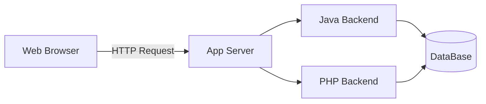

# PracticaMarkdown
<<<<<<< HEAD
## H2 Example
### H3 Example

=======


## H2 Example

### H3 Example
>>>>>>> origin/markdown

Emphasis:
this is an *italic* example
this is a **bold** example
this is a ~~crossed~~ example

<<<<<<< HEAD

List:
=======
List:

>>>>>>> origin/markdown
- 1 Item 1
- 2 Item 2
    - Subitem 2.1
        - Subitem 2.1.1
<<<<<<< HEAD

=======
>>>>>>> origin/markdown
Ordered list:
1. First
2. Second


Link:
[Link](https://example.com)

Image:


Quote:
> This is a quote


Code inline:
`System.out.println("Hello World");`

Block code:
```java
public class Hola {
    public static void main(String[] args) {
        System.out.println("Hello World");
    }
}
```


Table:
| Name | Age | City |
|:-------|----:|:----------|
| Ana | 25 | Granada |
| Juan | 30 | Jaén |

> [!NOTE]
> Text align: :--- left, ---: right, :---: center


Todo list:
<<<<<<< HEAD
- [x] Task 1
- [x] Task 2
- [ ] Task 3
=======
- [x] Task 1 (Done)
- [x] Task 2
- [ ] Task 3 (To do)
>>>>>>> origin/markdown
- [ ] Task 4


Alerts:
<<<<<<< HEAD
- Note: 
=======
- Note:
>>>>>>> origin/markdown
> [!NOTE]
> To show information.
- Tip:
> [!TIP]
> To show advices
<<<<<<< HEAD
- Warning: 
=======
- Warning:
>>>>>>> origin/markdown
> [!WARNING]
> To show must do or must not do info


Footnotes:
This is an easy example of a footnote[^1].
<<<<<<< HEAD
[^1] Here is the detailed explanation of the footnote.


Accordion:

<details>
<summary>Accordion example</summary>
- You can put html tags as **details**
- In the summary tag you put the accordion description
</details>
=======
[^1]: Here is the detailed explanation of the footnote.
>>>>>>> origin/markdown


Flowchart example:

<<<<<<< HEAD
=======


Image from other project location:


Link to other file from the project:
[Link to Changelog](CHANGELOG.md)


<details>
    <summary>FAQ(Frequently Asked Questions)</summary>
    <p><strong>Question 1?</strong> - Answer1</p>
    <p><strong>Question 2?</strong> - Answer2</p>
</details>
>>>>>>> origin/markdown
